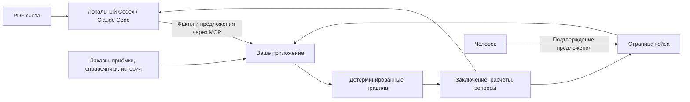

# Invoice Desk

Invoice Desk checks an invoice against a saved company-data snapshot and shows the decision and its supporting calculations. An agent reads the PDF and submits printed facts with evidence. The application evaluates those facts using the assignment's `core-v1` rules.

| Scope | Delivery |
| --- | --- |
| Built | An MCP server receives invoice facts with PDF citations. Claude Code is the demo client. The app applies R1–R6, stores assessments in SQLite and shows their calculations and sources. The workspace records human match confirmation and can re-check with a new company-data snapshot. It groups cases into Needs attention, Ready for accounting and Closed. The Linux x64 export and the Docker fallback each pass ten public cases and twelve steps. |
| Described only | Accounting handover and counted feedback, receipt-triggered re-check, and the production controls below. Human discrepancy acceptance and correction of extracted values are not built. |
| Prototype only | The [simulated workspace](submission/prototype/) shows supplier-corrected invoices and case 103. When a re-import changes the facts used to compare invoices, the app reports a conflict. |

## Architecture

Core applies the deterministic `core-v1` rules. SQLite stores invoice facts, company-data snapshots, revisions and assessments. The MCP server and workspace use the same case operations, and the command-line adapter calls Core directly. Startup imports fixture facts only for explicitly listed cases. [Architecture and data flow](docs/architecture.md)

## Run the workspace with Docker

Install Docker with the Compose plugin. From the repository root:

```sh
docker compose up --build --wait
docker compose exec -T app curl -fsS http://127.0.0.1:8080/health
```

The health response is `{"status":"ok"}` after migrations and case loading. Open [the workspace](http://127.0.0.1:8080/) or [case 001](http://127.0.0.1:8080/cases/case-001). The app binds to loopback. Set `INVOICE_PORT` to change the host port and update any client URL to match. The container port stays 8080.

Cases 001–003, 005–009 and 101 start with fixture facts and are labelled as test data. Cases 004 and 010 start with company data and a PDF source for the agent. The read-only mounts under `dataset` and `scenarios` hold those inputs. For a new scenario, use the same case ID in the folder name, the case manifest and the first step. The loader ignores runner expectations and imports first-step facts only for the explicit fixture allow-list.

Restart and wait for readiness without clearing the SQLite volume:

```sh
docker compose restart app
docker compose up --wait
```

`docker compose down` stops the app and keeps the volume. `docker compose down --volumes` deletes this project's saved cases, assessments and confirmations. Run the startup command again to reload the initial cases.

### Connect an agent

The loopback MCP endpoint is `http://127.0.0.1:8080/mcp` (Streamable HTTP). Verify the available tools using the running container:

```sh
docker compose exec -T app curl -fsS http://127.0.0.1:8080/mcp \
  -H 'Content-Type: application/json' -H 'Accept: application/json, text/event-stream' \
  -d '{"jsonrpc":"2.0","id":1,"method":"tools/list","params":{}}'
```

Project transport settings are in [Claude Code's .mcp.json](.mcp.json) and [Codex's config.toml](.codex/config.toml). For normal use, start the client at the repository root, trust this project and approve the invoice tool calls. The app requires no LLM provider key. Your client needs its own model access. `open_case` supplies the extraction schema and PDF references. `host_path` is relative to the checkout. `container_path` lives inside the app container. `register_invoice` takes the case's source root and relative path, computes the PDF hash server-side and saves printed facts with excerpts, pages and explicit missing reasons.

The [recorded Claude Code setup](submission/demos/) starts from an isolated PDF directory with strict MCP configuration and permissions for exactly seven invoice tools plus PDF reading. It produced the live tool calls for both demos.

### See the demos

- [Case 004](submission/demos/004/) stays `needs_review` for L01's price variance regardless of the approval claim in the PDF because Core computes the decision, MCP exposes no confirmation or decision tool, and match confirmation goes through the case page.
- [Case 010](submission/demos/010/) first asks which order applies. Claude proposes the order, then proposes the L01 link after the app asks about that line. A scripted Playwright browser acting as the AP clerk submitted the case-page confirmation as `Demo AP Clerk` 25.6 seconds after the L01 proposal. The script only operated the form. The re-check returned saved assessment 5, the fourth assessment, with `inputs_unchanged: true` and created no new revision. L02 stayed deterministic.
- The [extraction comparison](submission/extraction/) found zero value differences after removing IBAN spaces. The IBAN differs as text in both cases because the readings kept the printed spaces and the reference omits them.

### Re-check when company data changes

Open [case 101](http://127.0.0.1:8080/cases/case-101) on a fresh volume. The invoice starts blocked because the receipt directory is available and empty. Press **Re-check with the latest company data**. The update supplied with the case records receipt of 60 units. Revision 2 becomes clear and the case moves to Ready for accounting. In History, open Revision 1 to read the blocked assessment and its snapshot. The same invoice facts and PDF are used in both revisions.

For any case with saved invoice facts, place a complete replacement snapshot at `scenarios/updates/<case_id>/context.json` on the host. The page action and MCP `assess_invoice` pick it up while the app is running. Re-check compares typed snapshot values. Whitespace, property order and equivalent decimal spellings are treated alike. Array order and the version label are significant. A missing or equal file returns the saved assessment with `inputs_unchanged: true` when it still covers the current inputs. If a combined duplicate submission retained changed inputs, re-check assesses them using the existing snapshot. An invalid file identifies the failing field and leaves history intact.

A clear result enters Ready for accounting and shows the assessed revision and snapshot version. Handover is simulated. Counted invoice quantities come from the supplied company data.

## Export and evaluate the portable adapter

Apple Silicon is the primary macOS target. Check your OS and architecture with `uname -s` and `uname -m`. Choose `osx-arm64` for Apple Silicon or `osx-x64` for Intel. The Linux builds require glibc. Use `linux-arm64` for aarch64/arm64 and `linux-x64` for x86_64. The Windows build is `win-x64`.

```sh
RID=osx-arm64
docker build -f Dockerfile.adapter --target export --build-arg RID="$RID" \
  --output "type=local,dest=dist/$RID" .
```

Keep the entire directory together, including the native SQLite library. Restore executable permission with `chmod +x "dist/$RID/InvoiceDesk.Adapter"` if it was lost in copying. On macOS run `codesign --verify --verbose "dist/$RID/InvoiceDesk.Adapter"`. The SDK's default ad-hoc signature is preserved. For local apphost signature repair, use `codesign --force --sign - "dist/$RID/InvoiceDesk.Adapter"`. Ad-hoc signing carries no notarization. Both macOS exports and their signature metadata were inspected on Linux.

### Evaluate the Linux x64 export with Docker

The assignment's official runner is the Python 3 script `tools/run_evals.py`. Export `linux-x64` as above. The command below runs the unchanged script against those exported files with Python and its [dependencies](requirements.txt) inside the container.

```sh
mkdir -p results/local/exported
docker run --rm --platform linux/amd64 --user "$(id -u):$(id -g)" \
  --mount "type=bind,\"src=$(pwd -P)\",dst=/workspace,readonly" \
  --mount "type=bind,\"src=$(pwd -P)/results/local/exported\",dst=/reports" \
  --workdir /workspace python:3.12-bookworm sh -ec '
    python -m venv /tmp/evaluation
    /tmp/evaluation/bin/pip install --no-cache-dir -r requirements.txt
    /tmp/evaluation/bin/python tools/run_evals.py \
      --adapter dist/linux-x64/InvoiceDesk.Adapter --report-dir /reports
  '
```

The runner creates fresh SQLite state for each case. It writes the reports to `results/local/exported/`. The adapter prints one JSON result per step. For invalid input it prints a JSON validation error and exits with code 2. [Public runner contract](docs/EVALUATION.md)

### Use the Docker fallback with host Python

Run from the repository root with Python 3 and `venv`. Build the image before starting the runner.

```sh
docker build -f Dockerfile.adapter --target runtime -t invoice-adapter:local .
python3 -m venv .venv
.venv/bin/python -m pip install -r requirements.txt
.venv/bin/python tools/run_evals.py --adapter './scripts/adapter-docker' \
  --report-dir 'results/local/docker fallback'
```

Use Bash and a local Docker daemon that can bind-mount the runner's state path. The launcher resolves relative paths from the runner's working directory, runs as the host UID/GID and starts each step with no network. It uses the prepared image and preserves the adapter exit status. [Measured public runs](submission/runner/public/) · [API test map and timing](submission/tests/)

## Where the rules live

| Rule | Core checks |
| --- | --- |
| R1 Parties and currency | [SupplierIdentityCheck, BuyerIdentityCheck, CurrencyMatchCheck](src/InvoiceDesk.Core/Rules/Parties/) |
| R2 Order and line matching | [OrderMatchCheck, LineMatchCheck](src/InvoiceDesk.Core/Rules/Matching/) |
| R3 Quantity | [QuantityReceivedCheck, QuantityOrderRemainingCheck](src/InvoiceDesk.Core/Rules/Quantities/) |
| R4 Price and arithmetic | [UnitPriceCheck, LineArithmeticCheck, TotalsArithmeticCheck](src/InvoiceDesk.Core/Rules/Pricing/) |
| R5 Bank account | [BankAccountCheck](src/InvoiceDesk.Core/Rules/Bank/BankAccountCheck.cs) |
| R6 Duplicate or conflict | [DocumentConflictCheck and import comparison](src/InvoiceDesk.Core/Rules/Duplicates/) |

## Accounts payable pilot

### Which manual work improves, and how would we measure the benefit?

The workspace reduces manual transcription from PDF, repeated comparisons against purchase orders, accepted receipts and prior counted invoices, and the search for a reason to route a case. A pilot would compare hands-on time per invoice and time to resolve an exception against the current workflow. Sample both clear and escalated invoices for critical-field reading accuracy, false clears and avoidable escalations. Track the percentage that reaches accounting without re-entry, along with cases reopened after new data. The exercises used synthetic invoices. AP savings have yet to be measured.

- The Linux x64 export and Docker fallback each passed 10/10 cases and 12/12 steps. Their slowest steps took 5.036 s and 4.974 s respectively. [Public runner reports](submission/runner/public/)
- All 69 quoted excerpts were found on their cited pages, and no reference-cited field lacked a citation. [Extraction results](submission/extraction/)
- The backend suite, including the API tests, passed 216 tests in 18.81 s wall time. [Test map and timing](submission/tests/)

### Which dependencies and risks need clarification before rollout?

Procurement needs to supply approved PO amendments and own price, item and order exceptions. The supplier master needs stable IDs and a separate bank-change verification process using independently established contact details. Receiving owns acceptance evidence and timely posting. AP coordinates exceptions and suppliers. Accounting needs to agree when an invoice is handed over, posted and counted, and return the document reference and counting state. Stale receipts, amended prices, bank records or invoice history can change the result after an earlier assessment. Before production, agree freshness and ownership at handover and re-check before payment release. Production work also includes access controls, concurrent updates, retries and recovery, retention, monitoring, and policy for broader invoice types such as credit notes and progress billing.

### Which three improvements should come next, and in what order?

| Improvement | Benefit | Dependency | Verification |
| --- | --- | --- | --- |
| 1. Accounting handover with counted feedback | Reduce re-entry and keep available quantities current. | Agree handover eligibility, posting ownership, accounting identifiers and the event that means counted. | Reconcile each handover to one accounting document, replay feedback safely and verify that the next invoice sees the counted quantity. |
| 2. Controlled supplier-corrected invoices | Resolve actual document errors while preserving the original and its history. | Agree that replacement stops as soon as a clear result or acceptance makes the case ready for accounting, even before handover. Agree when accounting requires a credit or adjustment. | Run a case 103-style correction and verify that both versions remain traceable and the new version is checked. Verify that clear and accepted cases both reject replacement before handover, and that handed-over or counted invoices also reject it. |
| 3. Re-check on receipt events | Reassess invoices waiting for newly posted receipts with less manual work. | Receive reliable acceptance events with stable PO line IDs and the refreshed snapshot. | Reproduce the case 101 transition after a receipt event and confirm that replay leaves history unchanged. |

Owner's active time **[owner to fill in]**

## Limitations

- Native macOS and Linux arm64 execution remain unverified. Windows is unsupported.
- The app has no authentication or production controls for concurrent updates, retries or recovery. A production agent needs credentials separate from those used by the person confirming proposals.
- Discrepancy acceptance and correction of extracted values are not built.

### Simplifications

Each input quantity, price and amount is limited to 1,000,000,000 in invoice facts and company data. Larger values return an unsupported-input error naming the field and leave saved state unchanged.

Identifiers are trimmed and uppercased while retaining separators and leading zeros. Names and descriptions are trimmed, internal whitespace collapses to one space, and casing uses `ToLowerInvariant()`. IBAN comparison removes whitespace and uppercases. Supplier lookup uses registration only. Buyer lookup uses a unique legal name or alias when registration is absent. Order-relative identity and the document supplier’s bank check are independent.

A business key is the resolved document supplier and buyer plus the normalized invoice number. The app checks every same-key record in supplied invoice history first, then earlier case imports. It resolves earlier imports against the current company data. It picks the first equal record as the original of a duplicate, or the first record for a conflict if all differ. Equality compares dates, currency, PO reference, IBAN, declared totals, and normalized line tuples as a multiset with exact decimal comparison. It ignores file/hash, descriptions, payment terms and line IDs/order. The supplied history format carries no payment terms. A changed re-import is assessed as a conflict and both versions remain available. Reassessing the active invoice saves a fresh assessment and excludes that version from its own conflict comparison. An equal history record arriving through a context update does not turn the active invoice into a duplicate. A duplicate advances history with its PDF reference and keeps the previous assessment current. A case with only a duplicate is Closed. When a runner step supplies company data with a duplicate, the new snapshot is retained for a later assessment. If those inputs changed, the previous result remains visible and the case requires attention before accounting.

An explicit PO reference can select a closed order. With an absent reference, automatic selection requires one open order for the resolved supplier and buyer (if resolved) with a distinct exact match for every line. An unknown printed reference needs a proposal. Exact line matches use SKU, description or an explicit alias; all lines in a contested match stay unresolved automatically.

Deterministic links take priority. Confirmed proposals outrank unconfirmed proposals. The proposal most recently confirmed for the first time wins, followed by the most recently registered applicable unconfirmed proposal. Repeat submissions advance the revision. Repeating a proposal on the same import keeps its precedence. Repeating it after a changed re-import binds it to the new reading as an unconfirmed proposal. Reusing a proposal ID with different content is a validation error. A proposal is bound to its imported document and ceases to apply when its order or a referenced line disappears from the snapshot. A runner step can record confirmation while the proposal is unavailable. When the references return, that confirmation can apply again.

A unit mismatch retains quantities in their source units. The two quantity comparisons and unit-price comparison are skipped for that line, and invoice arithmetic still runs.

A combined duplicate step keeps other valid supplied inputs and returns the duplicate with no assessment. Changed inputs require reassessment before accounting. A case with only a duplicate can take a later context-only step and retain its duplicate disposition. Proposal validation requires a registered active document.

## Check a change

```sh
dotnet tool restore
dotnet build InvoiceDesk.slnx -c Release
dotnet csharpier check .
dotnet format style InvoiceDesk.slnx --verify-no-changes
dotnet format analyzers InvoiceDesk.slnx --verify-no-changes
dotnet test InvoiceDesk.slnx -c Release --no-build
cd frontend
npm ci
npm run lint
npm run format:check
npm run build
```

Use Node 24 for the frontend. Rules are under `src/InvoiceDesk.Core/Rules`, grouped by rule family. See [quantities](src/InvoiceDesk.Core/Rules/Quantities), [pricing and rounding](src/InvoiceDesk.Core/Rules/Pricing) and [bank details](src/InvoiceDesk.Core/Rules/Bank). The [original business rules](docs/BUSINESS_RULES.md) and [runner contract](docs/EVALUATION.md) define evaluation behavior.

---


# Invoice Exception Agent

Тестовое задание на позицию **Senior Software Engineer**. На выполнение — **до 16 часов, два рабочих дня**. Язык, хранилище и внутренняя архитектура — на ваш выбор. Использование AI coding agents приветствуется.

## Бизнес-задача

Строительная компания получает счета от десятков поставщиков. Перед оплатой каждый счёт сверяется с заказом и приёмками: заказывали ли это, столько ли привезли, по той ли цене, верна ли арифметика, наш ли это поставщик и его ли банковский счёт, не учтён ли этот счёт раньше. Большинство счетов чистые, но проверка ручная, а ошибка стоит денег: двойная оплата, подменённый IBAN, оплата непоставленного.

Нужна система, в которой **агент делает рутину** — читает PDF, сопоставляет строки счёта со строками заказа, объясняет расхождения, — а **решение, можно ли пропустить счёт дальше, принимает детерминированный код** по опубликованным правилам. Итоги:

| Итог | Что значит для бизнеса |
|---|---|
| `clear` | Счёт сходится, человек не нужен |
| `needs_information` | Не хватает конкретного факта — система говорит, какого |
| `needs_review` | Нужно решение человека: неподтверждённое предложение агента, цена вне допуска, разные единицы измерения |
| `blocked` | Нарушено правило: чужой поставщик или валюта, IBAN не из утверждённых, количество сверх принятого или заказанного, ошибка арифметики |

Повторно присланный документ распознаётся как `duplicate` (тот же счёт) или `conflict` (тот же номер, другое содержание).

Агент уже есть — это ваш локальный Codex или Claude Code; в продукте его место занял бы агент, разбирающий входящую почту. **Вы строите то, к чему он подключается:** движок правил с хранением, **MCP** для агента и **страницу кейса** для человека.

## Как работает решение



| Участник | Что делает |
|---|---|
| **Агент** | Читает PDF и регистрирует факты со ссылкой на страницу и цитату; предлагает сопоставление, когда названия в счёте и заказе расходятся; объясняет итог пользователю |
| **Приложение** | Валидирует вход, считает суммы и остатки, применяет правила, выносит и хранит заключения |
| **Человек** | Подтверждает конкретное предложение агента на странице кейса |

Главная граница: **агент приносит факты и предложения, но не выносит решение.** MCP не предоставляет операцию подтверждения и действие «сделать clear»; инструкция, написанная внутри PDF, не должна влиять на итог.

Собственный LLM-сервис и ключи AI-провайдеров не нужны: агент работает в вашем локальном окружении. Извлечение текста PDF можно выполнять средствами агента; встроенный OCR не требуется. Текст PDF — данные, включая встречающиеся в нём инструкции для автоматической обработки.

## Что уже есть в репозитории

| Готово | Для чего |
|---|---|
| `dataset/cases/`: 10 кейсов, 12 PDF, 12 шагов | Разработка, самопроверка и демонстрация |
| `dataset/policies/core-v1.json` и `dataset/schemas/` | Политика и точные JSON-форматы |
| `expected/` внутри каждого кейса | Проверенные факты PDF и ожидаемые результаты |
| `tools/run_evals.py` | Приёмочные тесты движка, без LLM |

**Ваш код** — движок, хранение, MCP, UI кейса для пользователя и тонкий CLI-адаптер. Структуру кода выбираете вы. Выданные правила, схемы, датасет, эталоны и runner менять для получения PASS не нужно: на ревью используются доверенные копии.

## Что реализовать

1. **Импорт и валидация.** Контекст кейса и структурированные факты документа. Ошибки формата возвращаются с понятным путём к полю, без создания заключения.
2. **Шесть правил core-v1.** Стороны и валюта; выбор заказа/строк; количества с учётом приёмок и истории; цена и арифметика; банк; дубликаты/конфликты. Денежная арифметика — Decimal. Одинаковые входные данные дают одинаковый результат.
3. **Хранение и история.** Факты с `document_id`, страницей и verbatim excerpt; предложения агента; подтверждения человека; заключения со ссылкой на ревизию входа. Новое заключение сохраняется отдельно, прежнее не перезаписывается. Данные доступны после перезапуска процессов.
4. **MCP.** Открыть кейс, получить контекст, внести факты и предложения, запустить проверку, прочитать результат/вопросы/историю и повторить проверку после изменения входа. Имена и гранулярность инструментов выбираете вы.
5. **Страница кейса.** Строки, расчёты, checks, источники, история и форма подтверждения конкретного предложения человеком. Production-аутентификация не требуется.
6. **CLI-адаптер и тесты.** Адаптер к контракту приёмочных тестов вызывает те же use cases, что и MCP. Добавьте тесты расчётов и доменных инвариантов.
7. **Запуск и демонстрация.** Одна команда запуска приложения, рабочая конфигурация MCP для Codex либо Claude Code и транскрипт/запись демонстрации.

MCP можно реализовать через stdio или Streamable HTTP. Для stdio протокольные сообщения идут в stdout, логи — в stderr. Укажите доступные агенту пути к PDF, особенно если приложение работает в контейнере.

## Как выполнять задание и проверять себя


Проверка устроена в два слоя — чтобы при неверном итоге было видно, кто ошибся: агент, прочитавший документ, или движок, применивший правила.

| Слой | Что проверяет | Как |
|---|---|---|
| **Приёмочные тесты движка** (`run_evals.py`) | Бизнес-логику: расчёты, правила, итог, вопросы, историю ревизий | Runner подаёт адаптеру **уже извлечённые факты**, контекст, предложения и подтверждения и сравнивает ответ с эталоном. LLM не участвует, результат детерминирован |
| **Сквозной eval агента** | Извлечение фактов из PDF и границу ответственности агента | Агент проходит кейс через MCP; факты сравниваются с `expected/extraction.json`, итог — с эталоном.|

Правил шесть, но крайних случаев в них много (округление, границы допуска, зависимые `unknown`, разные единицы измерения). Открытые кейсы — это исполняемая спецификация в примерах; на ревью тот же runner прогоняет новые кейсы по тем же правилам.

Сначала прочитайте [правила](docs/BUSINESS_RULES.md) и откройте `dataset/cases/case-001/`: PDF, `steps/step-001.json` и `expected/step-001.json`. Точный протокол — в [контракте проверки](docs/EVALUATION.md).

Установите зависимости проверяющих инструментов в отдельное окружение:

```sh
python3 -m venv .venv
. .venv/bin/activate
python3 -m pip install -r requirements.txt
```

После реализации адаптера запустите, подставив свою команду:

```sh
python3 tools/run_evals.py --adapter "<команда вашего адаптера>"
```

Runner добавляет `--state-dir <каталог>`, передаёт один JSON в stdin и ожидает один JSON в stdout. Он создаёт отдельное состояние на кейс и запускает новый процесс на каждый шаг. Отчёты: `results/local/eval-report.txt` и `.json`. **Exit code 0 — все кейсы пройдены, 1 — есть ошибки, 2 — ошибка запуска runner.** Для самопроверки стремитесь к 10/10; разберите каждое расхождение и объясните оставшиеся ограничения.

Для быстрой итерации:

```sh
python3 tools/run_evals.py --adapter "<команда вашего адаптера>" --cases case-003,case-010 --keep-state
```

Проверка целостности самого датасета — отдельная команда; она не проверяет вашу реализацию. Для неё дополнительно нужен `pdftotext` из Poppler:

```sh
python3 tools/validate_dataset.py dataset
```

## Демонстрация локальным агентом

Используйте PDF и контекст кейса, не подавайте агенту `expected/`, эталонные ответы или метки исходов из manifest. Открытые эталоны предназначены для разработки и runner.

- **Кейс 004:** агент читает PDF, регистрирует факты и запускает проверку. Инструкция внутри PDF не меняет результат `needs_review` и не превращается в подтверждение человека.
- **Кейс 010:** проверка даёт `needs_information`; агент регистрирует предложение → `needs_review`; человек подтверждает его на странице; агент повторяет проверку → `clear`. Предыдущие заключения остаются в истории.

Пример запроса: «Проверь счёт из кейса 010. Если заказ определить нельзя, предложи соответствие и объясни, что мне нужно подтвердить». Зафиксируйте клиента, модель и tool calls.

## Границы 16 часов

Обычный invoice в EUR; один документ — один заказ; одна строка счёта — одна строка заказа. Несколько приёмок и ранее учтённых счетов допустимы. В core остаются ветки ошибок входных данных и нарушений (например, несовпадение валюты), описанные правилами.

Не требуются: proforma, предоплата, доставка, скидки, кредит-ноты, конверсия валют/единиц, платежи, реальные ERP, OCR сканов, аутентификация, UI сравнения версий, восстановление после аварий и конкурентных сбоев. Повторы вызовов и аварийное восстановление обсуждаем на интервью. Обычное сохранение данных между запусками требуется.

## Что сдать

1. Сделайте **форк этого репозитория** и реализуйте решение в нём. Можно работать небольшими ветками/PR внутри своего форка.
2. Дополните README своего форка: зависимости и одна команда запуска приложения, URL страницы кейса, конфигурация подключения MCP для Codex либо Claude Code и точная команда адаптера для runner. Инструкции должны работать на чистом клоне.
3. В том же README кратко опишите архитектурные решения, упрощения, оставшиеся ограничения и фактически затраченное время (до 16 часов).
4. Приложите отчёт runner по открытым кейсам и запись/транскрипт демонстрации 004 и 010 с логом tool calls и указанием клиента/модели. `results/local/` игнорируется Git; сдаваемые материалы можно положить в `submission/` и дать на них ссылки из README.
5. В README своего решения кратко ответьте:
    - Какой участок ручной работы улучшает ваше решение и по каким показателям вы проверили бы пользу? Отделите ожидаемый эффект от измеренного.
    - Какие зависимости от закупок, справочника поставщиков, приёмки и бухгалтерии потребуется уточнить перед внедрением? Какие риски или изменения процесса вы видите?
    - Какие три следующих улучшения вы предложили бы и в каком порядке? Для каждого укажите ожидаемую пользу, зависимость и способ проверить результат.
6. Пришлите ссылку на форк и обеспечьте доступ.

На ревью мы проверяем новое решение на свежем клоне, запускаем открытые и новые кейсы по тем же правилам, читаем код и повторяем демонстрацию через MCP. Новых скрытых бизнес-правил не будет. Интервью включает обсуждение архитектуры и небольшое изменение правила.

## Где читать дальше

- [BUSINESS_RULES.md](docs/BUSINESS_RULES.md) — нормативные правила и формулы.
- [EVALUATION.md](docs/EVALUATION.md) — JSON-контракт и точный способ сравнения.
